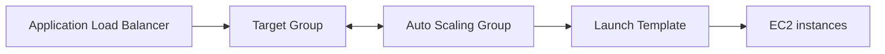

# Phase 1 Architecture — Terraform-based App1 Deployment

## Current implementation

```mermaid
flowchart TB
    Dev[Developer / Operator]
    Repo[GitHub repository\nTerraform source + environment configs]
    CLI[Terraform CLI / deployment script]
    State[(Amazon S3 remote state\nNative S3 lockfile: use_lockfile = true)]

    Dev -->|Select environment and run| CLI
    Repo -->|Source code and tfvars| CLI
    CLI <-->|Read / write state and lock| State

    subgraph AWS["AWS account — selected VPC"]
      ALBSG[ALB Security Group\nInbound TCP 80 from Internet]
      ALB[Application Load Balancer\nHTTP listener :80]
      TG[Target Group\nHTTP :80 + health checks]
      EC2SG[App1 EC2 Security Group\nInbound TCP 80 from ALB SG only]
      EC2[App1 EC2 instance(s)\nApache installed by user_data]

      ALBSG --> ALB
      ALB --> TG
      TG -->|Registered targets| EC2
      EC2SG -. protects .-> EC2
    end

    CLI -->|Creates / updates infrastructure| AWS
    Internet((Internet user)) -->|HTTP request :80| ALB
```

## Request flow

1. A developer/operator selects an environment configuration (dev, stg, or prd) and runs Terraform.
2. Terraform reads the configuration and manages infrastructure in the selected VPC. When `vpc_id` is null, the current configuration selects the default VPC.
3. The Application Load Balancer accepts HTTP traffic on port 80.
4. The ALB forwards requests to the target group.
5. Terraform's `aws_lb_target_group_attachment` resources register the App1 EC2 instance IDs with the target group.
6. The App1 EC2 security group permits HTTP traffic from the ALB security group, rather than directly from the Internet.
7. EC2 user data installs Apache and serves the basic App1 page.

## Current scope and implementation notes

- App1 uses standalone EC2 instances through the EC2 module.
- ALB, listener, target group, security groups, and explicit target-group attachments are managed by Terraform.
- Remote state is stored in S3, with native S3 lockfile locking enabled using `use_lockfile = true`.
- The environment configurations currently define App1 instance counts.
- **An Auto Scaling Group is not yet integrated** into the current App1 deployment path.
- GitHub Actions, the React portal, FastAPI backend, and automated Ansible deployment are future phases, not part of this implemented Phase 1 flow.

## Planned evolution — Auto Scaling Group

The following is a future design, not the current implementation:



With ASG integration, instances should register and deregister with the target group through the ASG attachment rather than relying on per-instance Terraform target-group attachment resources.

## Phase 1 system-design review checklist

- **Availability:** What happens when an EC2 instance fails its ALB health check?
- **Failure domains:** What happens if an Availability Zone becomes unavailable?
- **Security:** Why can the EC2 security group accept HTTP only from the ALB security group?
- **State safety:** How does S3 state locking prevent concurrent Terraform operations?
- **Deployment safety:** How would a failed infrastructure change be detected and recovered?
- **Scaling:** What changes when standalone EC2 instances are replaced by an ASG?
- **Zero downtime:** What additional deployment strategy is required for blue/green releases?
